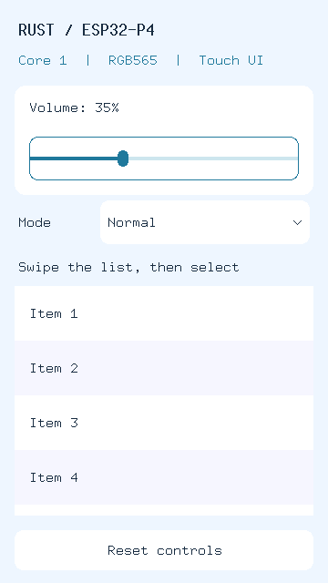

# 纯 Rust UI 组件框架与 P4 示例

通用组件保留为独立的 tiny-ui crate；演示与原 Slint 一样直接使用根 package 的 bin，不另建演示 crate。旧 Slint 程序保留作对照：

| 层次 | 路径 | 职责 |
| --- | --- | --- |
| 可复用框架 | [`3rd/tiny-ui`](../../3rd/tiny-ui/README.md) | `Scene<N>`、组件、输入捕获/焦点、脏区绘制，无页面 ID/板级依赖 |
| 页面模块 | `src/bin/demos/rust_ui_demo/page.rs` | 组合组件、业务状态、标签更新与复位策略 |
| 固件适配 | `src/bin/demos/rust_ui_demo.rs` | GT911 输入、屏幕映射、PSRAM/DMA 双缓冲 |
| 原版参考 | `ui/demo.slint` / `slint_demo` | 原 Slint 控件展示页面，不修改或移除 |

框架与固件使用 `no_std`，页面模块不使用 `alloc`。框架只依赖 `embedded-graphics 0.8`，
不依赖 HAL、Slint、第三方板级补丁或操作系统。它是第一版固定容量保留式组件框架，
不是完整复刻 Slint 语言、布局引擎或运行时。

## 对照原 Slint 效果



复刻的是 `ui/demo.slint` 的 **360×640 控件展示页**，不是 `ui/desktop.slint` 的完整桌面：

- 浅蓝背景、圆角白色音量区域、0–100 滑条，初始音量 35。
- Mode 下拉框：Normal、Quiet、Music、Game，弹出菜单位于上层并捕获输入；点击外部只关闭，不穿透点击列表。
- 30 行 Item 列表，60 像素行高；拖动滚动、点选高亮并更新标签。拖动不产生误点击。
- Reset controls 恢复音量 35、取消列表选择，按原 Slint 页面逻辑保留模式和滚动位置。
- 输入接口支持 Tab / Shift-Tab 切换焦点、方向键调整滑条/选项、Enter/空格激活、Escape 关闭弹出层；由主机测试覆盖，固件未接入实体键盘。

差异明确保留：标题标记 RUST；字体使用 ASCII 位图字体（18/20 像素），没有 Slint 的字体抗锯齿、
精确原生控件皮肤或动画。当前列表为矩形裁剪（与原圆角容器边缘略有差异）、直接拖动，无惯性/回弹；没有自动布局、嵌套控件树或任意自定义控件 trait。
现阶段通过配置组件几何和样式组合页面；新控件类型需扩展框架 `Widget` 枚举。

## 固件运行

从仓库根目录：

```sh
cargo build --release --locked --bin rust_ui_demo
cargo run --release --locked --bin rust_ui_demo
```

无需开启 `slint-ui`。仍使用项目 stable 工具链、`riscv32imafc-unknown-none-elf`、
最低芯片版本 3.1 和现有 720×1280 MIPI 面板/GT911 驱动。
烧录前须确认板型、串口、引脚和供电安全。

- 360×640 逻辑画布放大 2 倍，覆盖整个 720×1280 面板；触摸坐标反向缩放。
- 核 1 独占 UI、触摸、显示；核 0 打印心跳。示例音量只是状态，不实际控制音频/背光。
- 固定 PSRAM 双缓冲仍为 `720 * 1280 * 2 * 2 = 3,686,400` 字节，核 1 栈 32 KiB。
- 沿用现有 RGB565→面板 BGR565 转换、`dpi.commit()` 缓存维护、三次 VSYNC 描述符重用等待。
- 每次重绘当前逻辑脏区与上一次逻辑脏区的并集；两缓冲在启动时完整初始化。
  局部绘制并不代表面板局部扫描或 DMA/cache 自动只处理脏区。
- 固定跟踪一条 GT911 contact ID；空报告才发 Up。触点失联/换指/500 ms 无报告发 Cancel，
  等全松开后重新接受输入。固件尚未接入实体键盘；键盘事件仅由主机测试注入。

## 组件复用与业务事件

在另一 crate 中依赖 `tiny-ui`，创建任意 viewport 的 `Scene<N>`，向其添加任意位置的组件。
每个组件有用户指定 `WidgetId`；`scene.handle(Event)` 返回 `{ id, kind }`，
业务层处理 `Clicked` / `ValueChanged` / `SelectionChanged`，不在控件内执行 Wi-Fi 或其他外设操作。

业务层通过 `scene.update(id, ...)` 修改数值、文本、样式、可见性等；框架合并旧/新绘制范围。
每个脏区域先恢复背景，再按层序重画组件和 popup。框架不拥有 framebuffer，
只接受 `DrawTarget<Color = Rgb565>`；可接单缓冲、扫描输出或由应用管理 A/B 双缓冲。

容量固定：Scene 组件上限由 const 泛型决定；Label 文本为 96 字节内联缓冲，超长按 UTF-8 边界截断；
列表/下拉项为静态借用切片。容量/重复 ID 插入返回错误。未来需要动态数据源时可新增数据模型接口，
不必让整个核心依赖 alloc。

## 主机测试与验证边界

从仓库根目录执行 `python3 tools/test_rust_ui_demo.py`，直接测试 bin 的页面模块；
11 项页面集成测试位于 `tests/rust_ui_demo.rs`，17 项组件测试位于 `3rd/tiny-ui/`。
完整命令见 [测试导航](../../tests/README.md)。不再提供独立演示 crate、HTTP 服务或浏览器预览。
本文图片保留为未改变场景的软件渲染参考，来自此前实际 Rust 软件渲染输出，
不是本次重新生成的截图、Slint 截图或硬件照片。

真实面板、GT911、cache/DMA 时序、显示帧率及 USB 音频/无线共存尚未在本次改动中实测。
纯 Rust 页面与组件测试不能替代这些硬件验证。
本固件不启动音频、无线或 USB 服务。软件验证记录见 [仓库验证记录](../REPOSITORY_LAYOUT.md)。
